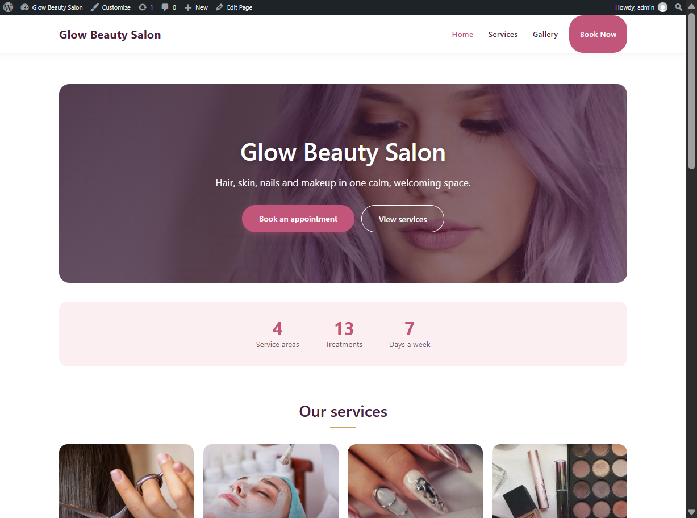
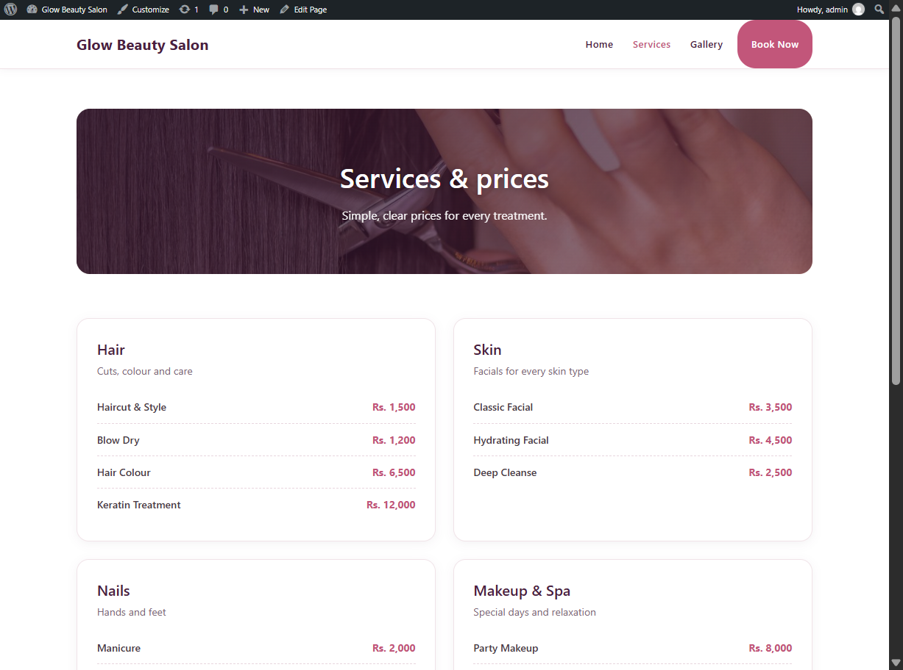
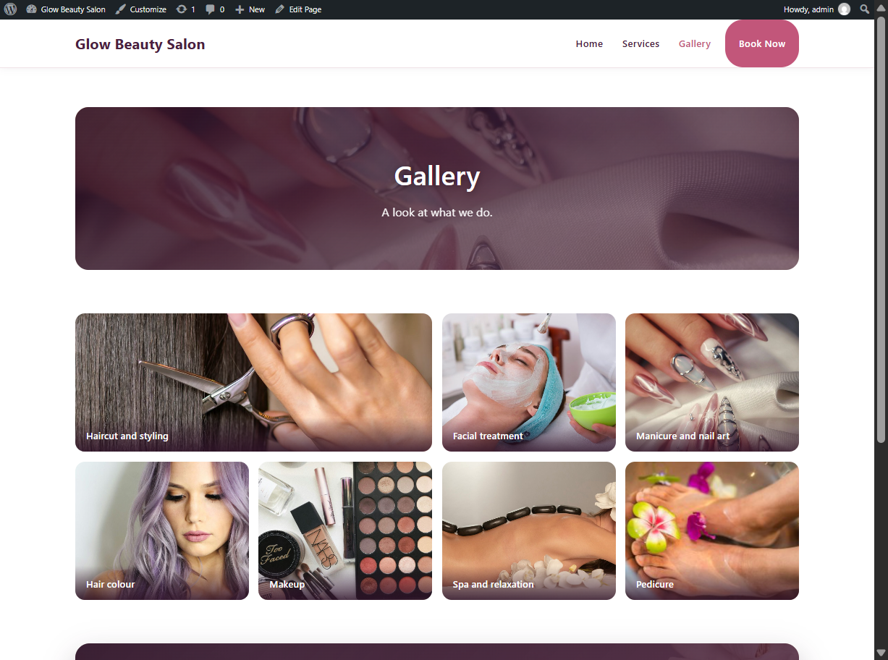
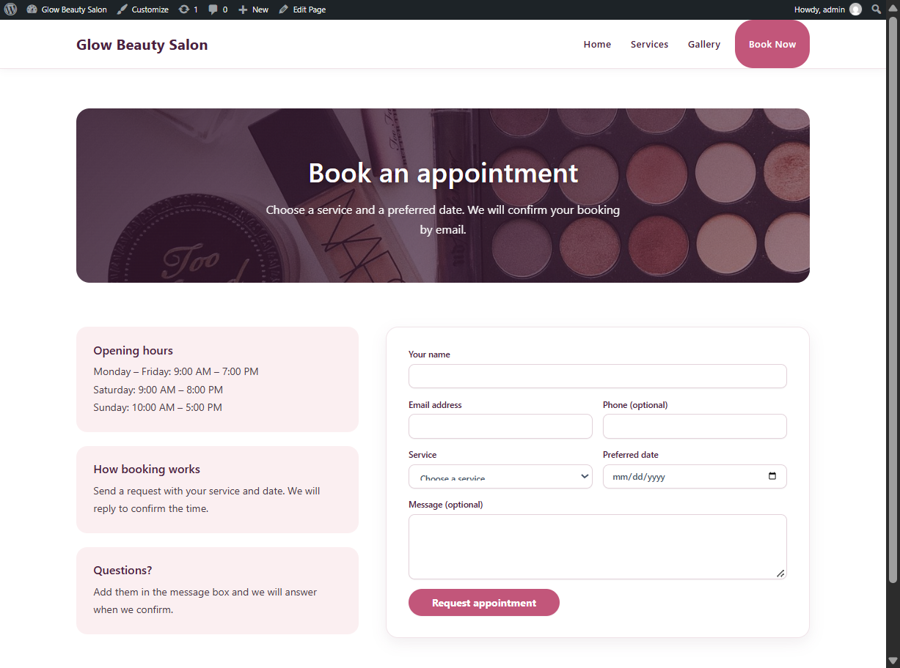

# Glow Beauty Salon

A responsive beauty salon website built with **WordPress**, the free **Astra** theme, and a custom PHP plugin. The website includes Home, Services, Gallery, and Contact pages, with an online appointment request form.

The project is designed as a portfolio project and runs in a local WordPress environment using WAMP.

> **Important:** Treatment names, prices, and opening hours are sample content. Add the correct business details and review all sample information before using the website for a real salon.

## Website Screenshots

### Home Page


### Services and Prices


### Gallery


### Contact and Appointment Booking


## Features

### Website Pages
- Home page with a hero section, service tiles, gallery, opening hours, and booking links.
- Services page with a price list arranged into four groups.
- Gallery page displaying salon-related images.
- Contact page with an online appointment request form.
- Responsive layout for desktop, tablet, and mobile screens.
- Custom plum, rose, and gold styling.

### Services
The sample service list contains 13 treatments in four groups:

| Category | Sample treatments |
|---|---|
| Hair | Haircut & Style, Blow Dry, Hair Colour, Keratin Treatment |
| Skin | Classic Facial, Hydrating Facial, Deep Cleanse |
| Nails | Manicure, Pedicure, Gel Polish |
| Makeup & Spa | Party Makeup, Head Massage, Relaxing Massage |

### Appointment Requests
- Customers can enter their name, email address, optional phone number, preferred service, preferred date, and an optional message.
- The form checks the required information on the server.
- WordPress nonce verification, input sanitisation, and a hidden spam-trap field are used.
- Submitted requests are stored in the WordPress dashboard under **Bookings**.
- An email notification is attempted using the WordPress site's configured admin email address.

Appointment requests are not automatically confirmed appointments. The salon needs to review each request and contact the customer to confirm availability.

## Technologies Used

- **CMS:** WordPress
- **Theme:** Astra (free)
- **Backend:** PHP (custom WordPress plugin)
- **Frontend:** HTML and CSS
- **Local development:** WAMP Server
- **Version control:** Git and GitHub

## Custom WordPress Plugin

The custom plugin is located in:

`plugin/glow-salon-setup/`

It provides the project-specific functionality:

- Creates the Home, Services, Gallery, and Contact pages during setup.
- Creates the main navigation menu and configures the homepage.
- Adds the appointment request form using the `[gb_booking]` shortcode.
- Stores appointment requests in a custom WordPress post type named **Bookings**.
- Adds the gallery using the `[gb_gallery]` shortcode.
- Loads the salon images into the WordPress Media Library during setup.
- Applies the custom website styling.

The plugin uses WordPress features such as shortcodes, custom post types, hooks, and an activation hook.

## Repository Structure

```text
glow-beauty-salon-main/
├── assets/                         # Salon images
├── docs/
│   └── screenshots/                # Website screenshots
│       ├── home.png
│       ├── services.png
│       ├── gallery.png
│       └── contact.png
├── plugin/
│   └── glow-salon-setup/
│       ├── css/
│       │   └── glow-salon.css      # Custom styling
│       ├── images/                 # Images used by the plugin
│       └── glow-salon-setup.php    # Main plugin file
├── .gitattributes
├── .gitignore
└── README.md
```

This repository contains the custom plugin, project images, screenshots, and documentation. It does not contain the complete WordPress installation or a database export.

## Local Installation (WAMP)

### Requirements
- WAMP Server
- WordPress
- Astra free theme

### Installation Steps
1. Start WAMP Server.
2. Create a MySQL database, for example `salon_db`.
3. Install WordPress in the local web directory, for example `C:\wamp64\www\salon`.
4. Log in to the WordPress dashboard.
5. Install and activate the **Astra** theme.
6. Create a ZIP file of the `plugin/glow-salon-setup/` folder.
7. In WordPress, go to **Plugins → Add New → Upload Plugin**.
8. Upload the plugin ZIP file and activate **Glow Salon Setup**.
9. Go to **Settings → Permalinks**, select **Post name**, and save the changes.
10. Open the website and check the Home, Services, Gallery, and Contact pages.

## Configuration Notes

- Update the sample service prices and treatment information in the `gb_services()` function if needed.
- Update the sample opening hours in the page content before using the website for a real salon.
- Configure the WordPress site name and admin email address.
- WordPress email delivery depends on the local or hosting server's mail configuration. A local WAMP setup may need additional mail configuration for email notifications to work.

## Security and GitHub Notes

- The `.gitignore` file excludes WordPress configuration files, SQL dumps, logs, uploaded files, cache files, and environment files.
- Do not commit database passwords, private keys, customer information, or production configuration files.
- Use your own local WordPress installation and database.

## Learning Outcomes

Through this project, I gained practical experience in creating a WordPress website, developing a custom PHP plugin, using WordPress hooks and shortcodes, creating and validating an appointment request form, managing submitted requests in the dashboard, applying responsive CSS styling, and using Git and GitHub for version control.

## Photo Credits

The salon photographs are from Unsplash and are credited in the original project documentation:

- Makeup flat lay: Jazmin Quaynor
- Hair colour: Kareya Saleh
- Haircut: Daria Andriianova
- Facial and spa: Engin Akyurt
- Manicure: De Aura
- Pedicure: Rune Enstad
